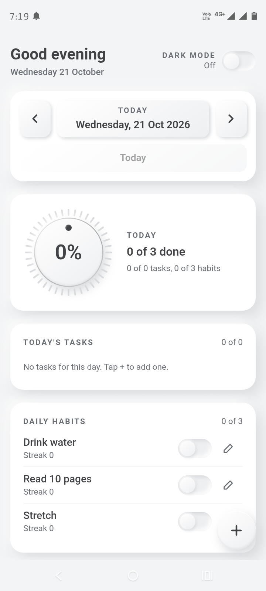
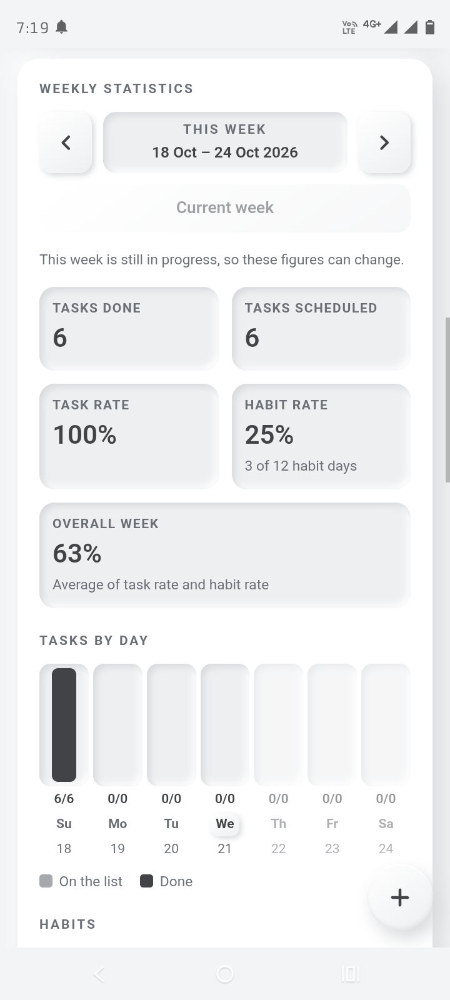
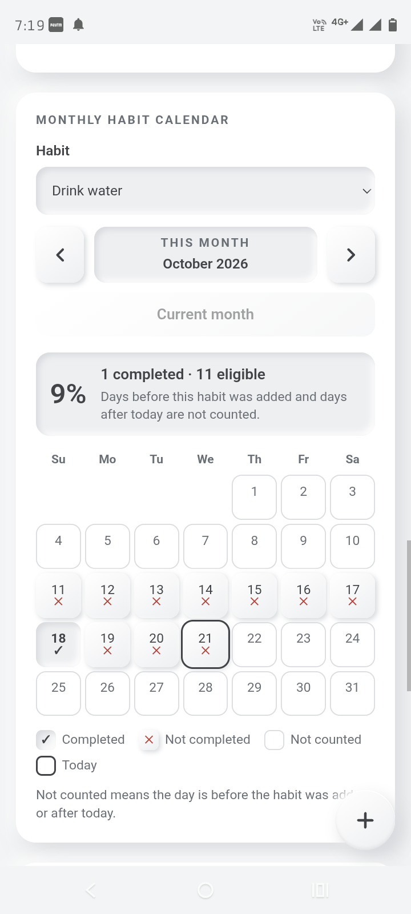

HabitBoard 📋

A personal task and habit tracker with a soft-skeuomorphic design, weekly statistics, a monthly habit calendar, and Light and Dark modes.

🌐 "Open HabitBoard" (https://ramanandasahoo.github.io/habitboard/)

✨ Features

- Task management: Add, complete, edit, and organize daily tasks.
- Habit tracking: Track daily habits and monitor your consistency.
- Weekly statistics: Review task completion and habit progress.
- Monthly habit calendar: View habit completion history across the month.
- Daily notes: Save notes and review your previous entries.
- Light and Dark modes: Choose your preferred appearance.
- Daily reminders: Test notifications and add recurring calendar reminders.
- Backup and Restore: Export your data and restore it from a backup file.
- Offline support: Use the installed Progressive Web App (PWA) without an internet connection.

📱 Try the app

Visit the live app:

https://ramanandasahoo.github.io/habitboard/

On a compatible Android phone, open the link in Chrome and use the browser's install option to add HabitBoard to your home screen.

🔒 Privacy and storage

HabitBoard stores your tasks, habits, notes, and history locally on your device. Data is not automatically synchronized between devices. Export backups regularly to protect your information.

Background notifications depend on browser and Android support and may occasionally be delayed or skipped. Calendar reminders depend on your calendar app's settings.

🛠️ Built with

- HTML
- CSS
- JavaScript
- Browser Local Storage
- Progressive Web App technologies
- GitHub Pages

🚀 Project status

HabitBoard is an ongoing personal project. Features and design may evolve over time.

📄 License

No license has been specified yet. All rights remain with the copyright holder unless a license is added to this repository.

## 📸 Screenshots

### Main Dashboard

### Weekly Statistics

### Monthly Habit Calendar

📲 How to Install

1. Open the "HabitBoard live demo" (https://ramanandasahoo.github.io/habitboard/) in Google Chrome.
2. Open Chrome's menu (three dots).
3. Select Install app or Add to Home screen, if available.
4. Open HabitBoard from your home screen.

💾 Data & Offline Use

- HabitBoard stores your data locally in your browser.
- Your tasks and habits do not automatically sync across devices.
- Use the Backup & Restore feature to save a copy of your data.
- After installation and the initial setup, supported features can work offline.

🔒 Privacy

HabitBoard is designed for personal use. Your information is stored locally on your device; clearing browser or app data may erase it. Back up your data regularly.

⚠️ Current Limitations

- Local storage: Data stays in the browser or app on the device where it was created.
- No cloud sync: Tasks, habits, and notes do not automatically sync between devices.
- Notifications: Reminder delivery may depend on browser permissions, Android settings, and battery restrictions.
- Backups: Export a backup regularly to help protect your data.
- Data recovery: Clearing app or browser data may permanently remove locally stored information if no backup exists.

🤝 Contributions

Suggestions, bug reports, and improvements are welcome. Please test changes before using them with important personal data.

💬 Feedback & Suggestions

Have you tried HabitBoard? I'd love to hear from you!

- 🐛 Report a bug or tell me about a problem.
- 💡 Suggest a feature you'd like to see.
- ⭐ Share your experience to help improve the app.

👉 "Submit Feedback" (https://forms.gle/Dtvp9nqBp8pFVRLz5)

Your feedback helps make HabitBoard better for everyone. Thank you for trying it!
